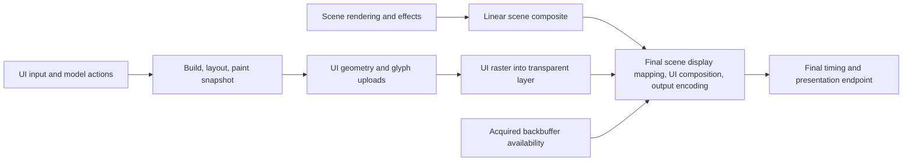

# Custom UI and offscreen composition

The engine-owned UI toolkit lives under `impl/ecs_ui/toolkit/`, with its ECS/runtime adapter under `impl/ecs_ui/`, reusable native services under `core/os/`, and typed skin/font assets in their own asset domains. Application callbacks declare controls over retained state. CPU preparation freezes immutable paint snapshots, independent GPU tasks rasterize one transparent UI layer, and final scene or standalone output consumes that layer through the shared task graph.

The stock controls include windows, panels, labels, separators, buttons, checkboxes, keyed lists, combo/searchable combo boxes, edit boxes, numeric editors, text areas, popups/modals, tooltips, context menus, radio groups, sliders, progress bars, and images. Native detached windows, docking, rich text, touch/pen, a full accessibility platform bridge, paragraph bidi/RTL editing, automatic wrapping, and generic variable-height scrolling require separate designs. Keep semantic roles, labels, values, and keyboard actions in the widget model. Platform capability reporting and native qualification determine which OS behavior is available.

Current domain READMEs define detailed public APIs: [CPU toolkit](../impl/ecs_ui/toolkit/README.md), [ECS UI](../impl/ecs_ui/README.md), [OS services](../core/os/README.md), and [skin assets](../impl/assets_ui_skin/README.md). Recorded measurement and qualification evidence is in the separate [custom UI report](reports/custom_ui_measurement_and_qualification_report.md).

## Ownership and data flow

```text
core/
  os/                         nwb_os: reusable OS services, no UI/ECS dependency
    text_input.h              composition sessions/events and caret geometry
    clipboard_service.h       clipboard/native selection exchange
    win32/                    native implementations
    linux/x11/                native X11 implementations
    linux/wayland/            native Wayland implementations
  frame/                      native window/event-loop owner; hosts OS services
impl/
  ecs_ui/                     nwb_ecs_ui: world callbacks and runtime adapter
    toolkit/                  nwb_ui: CPU toolkit, no ECS or GPU dependency
      context.{h,cpp}          identity, state, frame lifecycle, actions
      layout/                 measure/arrange, containers, scrolling
      input/                  hit testing, focus, capture, navigation
      text/                   fonts, shaping, text layout
      edit/                   Unicode model, commands, navigation, history, composition
      paint.h, paint*.cpp      primitives and immutable paint output
      widgets/                controls composed from the above services
      images/                 immutable owned texture sources
      widgets/*_style.h        skin region resolution, metrics, control states
      gpu/                    nwb_ui_gpu: uploads, atlases, raster, resources
  assets_ui_skin/             typed skin/atlas asset, author fields, cook, runtime load
  assets/graphics/ui/          raster shaders and .nwb metadata
  assets/ui/skins/default/     one default skin texture and atlas .nwb
tests/
  unit/os/                    service/session contracts using test doubles
  unit/ui/                    CPU toolkit edge-case tests
  unit/ecs_ui/                borrowed native/edit host contracts
  unit/ecs_graphics/          renderer/UI integration contracts
  smoke/                      interactive gallery and GPU captures
```

`nwb_ecs_ui` depends on `nwb_ui`, `nwb_ui_gpu`, the OS service interfaces, and the existing ECS/input/runtime modules. `nwb_ui_gpu` depends on the CPU paint contract and existing graphics, asset, and task modules. The renderer consumes a generic prepared presentation layer, never widget classes. `nwb_os` has no dependency on `impl/`, ECS, or graphics. Widget/layout policy stays in `impl/`.

`core/os/` provides clipboard/native-selection and text-input/IME services; broader window services can extend that module separately. `Frame` owns native windows and event pumping, constructs the OS service implementations using borrowed native window/display handles, and forwards required native messages. Keep those handles private to platform adapters. Required service references flow through `ProjectRuntimeContext` (`loader/project_entry.h`) and are borrowed by `UiLayerSystem` and `UiPaintContext`; avoid global lookups and a reverse dependency from `nwb_os` to `nwb_frame`. Native resources outlive their service objects, and service objects outlive borrowers.

Use an immediate/declarative builder over retained state. Application callbacks describe the current UI; stable IDs retain focus, selection, window placement, scroll offsets, and edit history. This preserves the convenient callback workflow while allowing independent layout, painting, and rendering. Avoid an entity or GPU task per widget.

Core contracts:

- `Ui::Context` owns a context-local state store using an explicit caller-owned arena. IDs include the UI root/entity generation, parent scope, and a stable application key. List item IDs follow model keys rather than row numbers. Diagnose duplicate IDs; retire removed state and release its focus/capture safely.
- `Ui::Builder` declares controls and layout. `UiPaintContext` exposes the builder, paint and text services; application models remain application-owned. Define action timing: process queued input against the last committed layout, commit typed actions/model changes on the owning thread, then build/layout/paint the next frame. Do not imply that a newly laid-out control was hit-tested before it existed.
- `Ui::PaintBuilder` emits ordered solid rectangles, skin/image quads, glyph quads and clip operations. Rounded paths and arbitrary line primitives remain proposed capabilities. Controls never record graphics commands. Initial clipping can use intersected rectangular scissors; complex path/stencil clipping is a later feature.
- `Ui::DrawSnapshot` owns immutable geometry, ordered draw commands, retained glyph/SDF/image sources, typed skin/texture identities, copied metadata, clip bounds, display metrics, and a generation. Its GPU owner retains resolved texture/font resource versions through completion; typed asset identities alone provide no lifetime retention. GPU work reads this snapshot, never live widgets, ECS data, or user callbacks.
- `Ui::SharedImageSource` and retained font/page versions are engine-owned immutable resources with explicit identities and generations. Use typed asset references for font/image asset bindings. Convert to backend resources and descriptor handles only in the GPU layer.
- Skin assets define atlas regions, state appearances, spacing, typography roles, borders, and colors. Widgets request semantic parts rather than hardcoded UVs. Store layout in logical units; convert to physical pixels consistently for painting, hit testing, scissors, and the IME caret rectangle.

Input, application callbacks, layout, and snapshot publication run on the main thread. Font-cache mutation has an explicit owner. Independent GPU scheduling does not require multithreaded widget callbacks; move pure shaping or tessellation of frozen data to CPU tasks only when representative measurements justify it.

Frame owns native windows, event pumping, and the borrowed clipboard/text-input service lifetime. Required service references flow through `ProjectRuntimeContext` to `UiLayerSystem` and `UiPaintContext`; native handles stay private to platform adapters. Native resources outlive services, and services outlive borrowers. The ECS adapter never destroys the shared native services.

Engine declarations follow root `engine_namespace.h`; Testbed uses its independent `namespace.h` with `TESTBED_BEGIN`/`TESTBED_END`. Loader entry functions delegate to project code. Engine/global macros use `NWB_` and application macros use `TESTBED_`. Project-owned interfaces retain the lowercase `interface` annotation. Build configurations are `dbg`, `opt`, and `fin`, with utility and build commands routed through `python -m launcher`. Graphics callers use the selected public backend contracts.

## Identity, layout, input, and declaration loans

Stable IDs combine the UI root/entity generation, parent scope, and application key. Retained state is typed and lifetime-scoped. Layout supports bounded rows, columns, overlays, fixed/content/stretch sizing, ancestor clipping, and logical DPI coordinates. State-family padding and minima keep hover/press changes from moving layout. Duplicate state ownership is rejected using full instance generations; frames admit at most 4,096 state claims. Small frames use 32 inline ownership pairs, and larger frames promote into an arena-owned hash set with retained capacity.

Input is routed against committed displayed geometry. Pointer capture, Tab/Shift+Tab focus, keyboard activation, modal barriers, and held input ownership survive until their defined release/cancellation boundary. Focus and key/button-release broadcasts visit all current handlers through mutation-safe dispatch. Camera routing uses `UiLayerSystem::wantsKeyboard()`, `wantsPointer()`, and `wantsTextInput()`; it respects the dispatcher's actual traversal and the owner of each held sequence.

The adapter publishes candidate hit geometry only when the matching UI output and exact native presentation receipt are accepted. A rejected or unknown acquisition cannot publish it. Acceptance is a queueing boundary and does not imply monitor scan-out completion. Resize, DPI/device changes, omission, recreation, root removal, focus/capture loss, and model/source replacement fence stale intentions before another owner can receive them. Double-click word selection and whole-run dragging use a separate tracker fenced by owner, popup, text revision, timing, and movement; word hits resolve accepted grapheme intervals. Uncaptured pointer motion between clicks preserves the sequence.

`BuilderScopeFrame` owns each declaration scope's transient layout, items, deferred control loans, container stack, and window/popup state in the UI arena. Application model/source/state loans last through the enclosing panel/window end or outermost popup end. Frozen output retains values and immutable resources rather than widget callbacks, live models, or native/ECS objects. Deferred controls retain their declaration's styles and geometry inputs, so later siblings cannot change earlier paint.

All deferred callbacks finish before source checks, a callback-free model-epoch pass, and joint loan release. Callback mutation rejects the candidate while preserving the application's mutation. Builder reset, declaration, configuration changes, and public host mutation during a live loan reject before borrowed storage is cleared. `Builder::setSkin()` rejects inside an open panel, window, popup, or deferred callback. `setTextShaping(scriptTag, language)` copies an explicit LTR language/script policy outside open scopes; automatic mixed-script paragraph layout is not implied.

## GPU work and final composition



Use separate tasks in the existing frame graph. Keep scheduling and submission in the existing lifecycle owner. UI raster requires Graphics capability; uploads use the existing built-ins. Let the compiler choose legal queues and packet placement. A separate task makes independent scheduling possible but does not promise simultaneous execution on a GPU with one graphics queue. Measure actual overlap with scene compute work before claiming a speedup.

### Integration contract

`Core::IGpuTaskGraphOutputLayerContributor` is a generic pre-output layer contract beside the existing presentation contributor. Its `declareTaskGraphOutputLayer(graph)` returns `Expected<Core::GpuTaskGraphOutputLayer>`; callers check admission before consuming the aggregate. Successful empty layers accept no work, while an unexpected result rejects graph construction. The prepared resource generations retain their existing lifetime through final-consumer acceptance. Preparation freezes CPU data and resolves resource readiness; declaration adds UI upload/raster tasks and returns a typed layer texture import, readiness task, extent, and an explicit linear/premultiplied color contract. Keep its types independent of `impl/ecs_ui/toolkit/`.

Declare this branch without a dependency on scene presentation or swapchain acquisition. In `DeferredGraphSuffixBuilder`, give the final output task dependencies on both scene composite readiness and layer readiness, and declare the UI texture read. The separate presentation contributor is a generic post-output extension. The suffix builder validates the explicit layer/endpoint shape, and renderer execution preserves the final timing endpoint, presentation signal and accepted-queue recovery behavior after all contributors.

The frame timer begins in `Core::FrameTimingBeginGraphTask::Record()`, declared in `core/task/gpu/frame_timing_begin_task.h`. The normal-execution prelude precedes both scene and independent UI branches; the frame ends after their final join. Standalone UI uses the same shared task contract. Timing recovery retains accepted work without making UI depend on shadow preparation to inherit its timing start.

The final compositor can sample the UI layer in the existing fullscreen output pass. There is no need for an additional full-screen pass merely to merge UI. A standalone UI-only path must also work when no scene renderer contributes: use a defined background and the same layer/output contract, acquire/present once, and avoid submitting the UI twice when a scene renderer already claims it.

### Render and color contract

- Allocate a transparent, single-sample color target at the physical presentation extent. Clear to `(0, 0, 0, 0)`. Use a linear `RGBA16_FLOAT` target as the quality reference, subject to device format support; evaluate a linear `RGBA8_UNORM` option against precision and bandwidth measurements.
- `tex_conv` converts authored sRGB image RGB to linear exactly once, generates linear mipmaps, and writes a metadata and raw UASTC sidecar pair; cooking derives checked mip records and packages the blocks; runtime UI textures and paint colors are linear. Treat glyph atlas samples as coverage. Generate premultiplied output and blend both color and alpha with `ONE, ONE_MINUS_SRC_ALPHA`; preserve draw order and merge only compatible adjacent batches.
- Composite with `result.rgb = ui.rgb + scene.rgb * (1 - ui.a)`, where both inputs use the same linear display color space and luminance units. `ui.rgb` is already premultiplied.
- For SDR, apply the existing scene exposure/tone mapping first, then UI composition, then the attachment's sRGB conversion. Keep UI appearance independent of scene exposure.
- For HDR10, the shared helpers separate display-linear scene mapping from PQ encoding. Convert mapped scene and UI into a common linear Rec.2020/nits representation, scale UI by the existing paper-white policy, composite, then encode PQ once. Do not apply the scene shoulder to UI or blend UI into already-PQ-encoded pixels.
- Use an absent-layer flag/variant for empty UI; skip UI raster and sampling without manufacturing empty presentation work. Pending font/texture uploads may still require upload/completion tasks.

An RGBA16F layer at 3840 x 2160 costs about 63.3 MiB before allocator overhead; three in-flight copies cost about 190 MiB. Budget this explicitly. Prefer adding one UI texture to the existing final pass over adding another scene-sized intermediate. Qualify damage tracking, cached subtrees, partial target updates, and alternate formats with representative measurements before adoption.

### Resource and failure invariants

- Bind one immutable snapshot and writable buffer/target set to each in-flight frame slot. Reuse them only after that slot's completion, not merely after a CPU frame count or successful submission.
- Declare all vertex/index/texture reads and render-target writes, including graph transitions and queue ownership. Bindless access does not remove the need for resource declarations. Reuse the existing alignment, retained upload, import-generation, and descriptor lifetime rules.
- Glyph atlas updates must not overwrite texels referenced by in-flight draws. Use safe append-only regions, versioned pages, or explicit synchronization. Eviction/repacking retires old pages and descriptors after their final use completes.
- Separate upload/raster submission acceptance from final-compositor submission acceptance and GPU completion. The offscreen raster callback reports producer acceptance only. The layer contract separately receives final-consumer acceptance and retains resources through its completion token. If raster is accepted and final output rejects, retain the layer/snapshot for a correctly synchronized retry or UI-only fallback without replaying input/actions. Retire after the last accepted consumer completes, or after producer completion when no consumer will use it. Keep the interaction-layout generation explicit when the displayed frame has not advanced.
- Create/resize targets, descriptors, and framebuffer-compatible pipelines in resource setup. Schedule dynamic atlas growth through preparation/setup; native record callbacks only consume prepared resources.
- Resize, DPI, output-format changes, minimize/restore, context destruction, rejected compilation, rejected submission, and device recreation need explicit invalidation/retirement behavior. A rejected graph must not mark uploads complete, reuse GPU-visible storage, or replay application actions.
- UI preparation failure before graph declaration can select an explicit scene-only frame with diagnostics. Failure after partial submission follows the existing frame recovery transaction. Do not silently present stale UI while hit-testing a newer layout.

Image widgets showing current scene results declare the real producer dependencies; applications may explicitly choose a safely versioned, completed preview when accepting its latency. Three target/buffer slots bound renderer admission. Rejected submissions retain immutable CPU data and accepted prefix tokens. Descriptors, framebuffers, textures, samplers, pipelines, and upload readiness remain owned through the final accepted consumer. UI paper white is 203 nits and is independent of scene exposure. The standalone adapter requests device recreation when rejection prevents completion of an acquired frame through the current void render-pass API.

## Native services and text input

| Owner | Responsibilities |
| --- | --- |
| OS feature layer (`core/os/`) | Native IME sessions and protocol handling; composition/commit events; candidate-window positioning; clipboard and native selection ownership/transfer; cursor shape; native capture and focus/capture-loss notifications. |
| Native frame (`core/frame/`) | Native window/display lifetime and event pump; creation/teardown of services; forwarding messages to the appropriate OS service and existing input dispatcher. |
| ECS UI adapter (`impl/ecs_ui/`) | Borrow service references, associate the focused control with a text-input session, map coordinates, route normalized events, and translate copy/paste/cursor/capture intents into service requests. |
| Toolkit (`impl/ecs_ui/toolkit/`) | Widget focus, caret/selected text range, edit buffer, undo/redo, validation, preedit display, and paint geometry. It emits platform intents and consumes normalized results without native APIs. |

Here, native selection exchange means OS-managed transfer such as a platform's primary selection channel. Its ownership and protocol belong to the OS layer. The edit box's selected range remains local widget state; the adapter can publish the selected text through an available OS channel. Neither clipboard ownership nor an IME session owns the widget's edit model.

Use capability-aware contracts rather than assuming every backend provides identical features. `ITextInputService` and `IClipboardService` are implemented; a broader `IWindowServices` remains separate work. Services are scoped to the native window/seat where needed. Native IME sessions report composition/preedit/commit/cancel and UTF8 byte selection ranges, accept surrounding text when supported, and accept the current caret rectangle. The borrowed edit host suppresses duplicate committed delivery through both the native session and `keyboardCharInput`.

Clipboard reads and native selection transfers use request/completion contracts so event-loop-driven backends do not require waiting for an external clipboard owner on the UI thread. OS tokens carry service/request generations; the adapter separately retains its widget/edit generation and rejects stale completions after focus changes, widget destruction, or cancellation. A cut removes selected text only after the copy operation succeeds. Return explicit unsupported/unavailable/failure results. The Windows backend executes admitted operations synchronously during the event-thread pump without retrying a busy clipboard; event-driven backends complete requests through native events. Keep native candidate-window rendering in the OS/IME and render only preedit/caret/selection within the widget.

All native service calls and callbacks obey their platform event-thread requirements. `ecs_ui` releases subscriptions, cancels pending requests, and ends its borrowed text-input session before destruction; it never destroys the shared clipboard/IME service. Focus loss has an explicit composition commit/cancel policy and releases native capture. Cover service lifetime, stale-token, boundary and failure cases with test doubles under `tests/`, independently of the UI, and qualify native implementations with platform smoke tests.

Win32 forwards mouse leave, capture change, cancel mode, focus, and aggregate key/character repeat counts. Complete UTF-8 scalar commits stay within bounded queues; overflow cancels atomically. Keydown distinguishes Press from Repeat and keyup emits one Release. The native context bridge preserves composition display-option bits outside the active editor's composition window, replays that policy on session begin, restores native composition on end, preserves default-procedure results, and fences reentrant cancellation.

X11 owns XIM/XIC and clipboard/primary-selection lifetimes, filter/lookup and character-to-UTF8 conversion, selection negotiation, bounded `INCR` transfers, and foreign-window failures. Retained outgoing bytes survive selection loss. Wayland owns offers/sources, bounded pipe progress, text-input-v3 batches, surface/seat/focus/serial eligibility, optional primary selection, and the exact surrounding-text slice sent to the compositor. Missing protocols report unavailable capabilities; direct commits do not establish preedit capability.

The OS event queue owns copied UTF-8 text and validated byte ranges. Service/session generations reject stale events; preedit may coalesce between commit barriers, and focus loss or overflow produces explicit cancellation. Native surrounding deletion uses the exact published revision, selection direction, and numeric bounds. Wayland Selection-based deletion preserves selected bytes while deleting the two outer intervals in one undo transaction; ordinary Caret-based deletion keeps its distinct contract. A rejected later commit preserves the accepted deletion prefix and retires pending native work.

The ECS edit host temporarily borrows the live model and applies copied native, key, pointer, clipboard, and navigation operations in their specified order. It retains no model pointer between calls. Widget/declaration/model, external-revision, selection, composition, navigation, and popup generations fence work even after values change away and back. Immutable Copy requests may complete after editing ends; cut deletes only after successful publication, paste is one validated history transaction, and stale completions cannot mutate another editor. Read-only fields permit selection and copy. Middle-button primary paste targets the focused control's current selection without transferring focus or moving the caret to the pointer.

Active preedit keeps editing keys and Enter with the native input method; Escape cancels composition before dismissing its editor/popup. The toolkit paints transient preedit without committing it to application text or undo history. Native IME candidate windows remain OS-owned. Clipboard shortcuts include Ctrl+Insert, Shift+Insert, and Shift+Delete with the same read-only, composition, repeat, and delayed-completion guards as ordinary copy/paste/cut.

## Fonts, shaping, and immutable glyph resources

FreeType supplies glyph rasterization and metrics, and HarfBuzz shapes positioned glyphs behind narrow engine text interfaces. Dependencies and Unicode 17 segmentation/property data are pinned through the repository's vendor/data process. The default Latin/Korean faces are deterministic licensed assets. Text remains UTF-8 with explicit byte/grapheme/cluster/caret mappings. Shaping has explicit direction, script, and language; bidi and line breaking need additional policies.

`ITextShaper::shape()` returns `Expected<ShapedRun, TextLayoutStatus::Enum>`; layout, metrics, and exact glyph rectangles also return checked results. Native shapers and glyph atlases retain reusable buffers. Layout is failure-atomic and retains source/font versions, advances, ink, clusters, and caret edges. Passive label caches invalidate on text/style and text-service/font-generation changes.

The current authoring format uses `font_builder` and one same-stem pair per face. `<stem>.nwb` declares independent `font face` and `font_atlas atlas` objects collected by `asset_bunch bunch = [face, atlas];`; `<stem>.font` is a FON2 version 1 binary containing exact original SFNT and compact images. The Font declaration has no fields. The atlas declares its Font reference, bake settings, editable vertical layout metrics and every glyph's advance plus group/channel, image rectangle and left/top plane origin when it has a bitmap, with `atlas.font = face;`. Every source glyph, including nondrawable glyphs, has one list record in source order; cooking derives its glyph ID from the ordinal, drawable state from bitmap presence, and right/bottom plane bounds from bitmap size and bake scale. Empty glyphs declare only required `advance_units`; fixed-zero geometry and derived glyph fields are rejected. Face index, units per em, glyph count, group dimensions/channels, and the fixed one-texel guard are derived, with no copied source facts or transport fields exposed in metadata. Nine significant float digits preserve f32 bits. The document has no version/revision or hash fields; integrity hashes remain inside the binary source. The bunch publishes `<metadata virtual path>/face` and `<metadata virtual path>/atlas`. Cooking derives the paired `.font` path from the original metadata document, admits mappings through the shared validator and copies original positioning tables from SFNT before publication. It reconstructs runtime assets without rasterizing at cook time. The `.font` source remains usable as a `font_builder` input for deterministic regeneration.

The Win32 and Linux builder publication paths stage, flush, and verify the complete pair before publishing `.font` and then `.nwb`. A partial pair or occupied work path fails; `--overwrite` replaces only a complete existing pair and restores it on publication failure. Engine defaults, UI consumers, and integration/quality tests use the current declarations and source pairs. FON2 has a 56-byte header, 48-byte image directory entries, exact SFNT and tightly interleaved compact pixels; glyph mappings/settings live only in `.nwb`. Cooked runtime FON1 version 1 and FTA1 version 2 stay separate from that source format. FTA1 uses 48-byte group headers with a channel count and independent rectangular dimensions; its version 1 is rejected. After four-plane shelf packing, the builder crops each group to its glyph bounds with the full one-texel guard and removes unused trailing planes. The GPU uploader selects R8/RG8/RGB8/RGBA8 UNORM, expanding RGB8 once to RGBA8 only when sampling is unsupported. The SDF scale policy remains unchanged. The [font-atlas contract](font_atlas_plan.md) gives the current layout and validation rules; it defines the supported source and runtime layouts.

Current default identities are `engine/ui/fonts/default/latin/face` and `/latin/atlas`, plus their `/korean/face` and `/korean/atlas` equivalents. Both faces bake at 32 ppem with spread 8. Latin's 1024 × 1024 RGBA8 and 1024 × 1023 RG8 groups use 5.998046875 MiB; Korean's two 2048 × 2048 RGBA8 groups, one 2048 × 2047 RGBA8 group and one 2048 × 1209 R8 group use 50.353515625 MiB. GPU allocations can include driver alignment and tiling overhead.

The default Latin and Korean atlas assets contain 3,748 and 24,964 glyph records respectively. Font images use lossless transport. SDF painting uses the interval 0.75..1.5 times bake ppem in physical pixels, with native coverage outside it. For default 32-ppem/spread-8 atlases, that is 24..48 physical pixels per em. The quality gate compares Latin A/o/e and Korean Hangul against supersampled native rendering, requires at least 32 glyph/scale comparisons, limits maximum edge displacement to one pixel, and limits maximum mean coverage error to 0.04. This interval is a quality policy and does not imply arbitrary zoom support.

Glyph coverage pages are linear R8, append-only, versioned, bounded, and retained through accepted uploads and draws. Snapshot-local image identities distinguish Latin, Korean, and fixture sources. SDF channels are independent scalar distance pages; shaping consumes original SFNT positioning data once, preserving `kern`, `GPOS`, and `GDEF` bytes without quadratic pair expansion or a second positioning application.

Text paint keeps complete measurement, clusters, caret, and selection geometry while using conservative outline/ink bounds to prepare only candidate visible glyphs. It admits a combined coverage/SDF image set before emitting glyph quads, and reuses prepared rectangles, UVs, and page choices. Empty clips and zero alpha leave preparation untouched after validation. Temporary candidate storage uses scratch; retained layouts and snapshots own immutable versions. Prepared paint adds 48 scratch bytes per conservative glyph candidate beyond its index array, so large visible layouts need an explicit transient-memory budget. Do not skip static CFF glyph loads based on assumed purity: Type2 `random` can mutate FreeType subfont state and affect later output.

## Skin authoring and selection

Ship exactly one engine-default skin texture with one accompanying atlas-info `.nwb` asset. Users can provide a replacement texture and atlas `.nwb` through the same asset pipeline and choose that skin through a typed `AssetRef<UiSkin>`. Widgets and their interaction code remain the same. The existing texture pipeline may also require its normal texture metadata/payload files; those are texture packaging, not an additional skin configuration format.

`impl/assets_ui_skin/` provides an engine-owned `UiSkin` asset using the existing typed asset, metadata, binary payload, cook, and load conventions. The skin stores a typed `AssetRef<Texture>` and validated atlas/style data. Keep CPU asset decoding independent of graphics; the UI GPU layer resolves the texture through `impl/assets_texture/loader.h`, reusing its resource/descriptor lifetime machinery. The metadata type is registered with the existing MetaScript `.nwb` asset pipeline. Current versionless field syntax is documented in `impl/assets_ui_skin/README.md`; the semantic roles and policies are listed below.

Follow `impl/assets_sampler/` for the small asset module: schema/asset header, versioned binary payload, runtime codec, cook implementation, volume registration, and separate runtime/cook CMake targets. Register in `impl/CMakeLists.txt`; retain the cook registrar through `pipeline/asset_builder/CMakeLists.txt` and the runtime codec registrar in consuming application links such as `CoolStuff/Testbed/CMakeLists.txt`. Extend the existing asset integration tests with skin cook/load coverage.

Declare packaging dependencies explicitly. The dependency tool keeps pass-through behavior by default and expands selected skin-to-texture metadata references with `--include-skin-dependencies`. Provide roots containing both the atlas and referenced texture metadata/payload; targeted expansion uses the same root ownership as the builder. Changes to either texture content or atlas metadata must invalidate the right cooked output. Do not imply that the current texture cooker consumes arbitrary PNG files directly; authoring artwork goes through the established texture conversion workflow.

| Atlas information | Purpose and rules |
| --- | --- |
| Texture reference | Identify the existing texture asset; track texture changes as asset dependencies. |
| Atlas extent and reference pixel density | Validate coordinates against the actual texture and convert artwork dimensions into logical layout units. |
| Named regions | Top-left origin pixel rectangles `(x, y, width, height)` with a fixed UV convention; names identify appearances such as `button.normal`, `edit.focused`, `checkbox.checked`, and `combo.arrow`. UVs are derived by the asset/runtime layer. |
| Draw mode and slice insets | Support a simple sprite and nine-slice stretch for resizable panels/buttons/edit boxes. Validate left+right and top+bottom against region bounds. Preserve corner sizes; define the minimum control size and behavior below it. Tiling is a later optional mode. |
| Content metrics | Logical padding, minimum sizes, border thickness, and optional alignment/pivot information. Keep content padding separate from the nine-slice border. |
| Semantic part/state mappings | Map widget parts and normal/hover/pressed/disabled/selected states to region IDs. Focus is an independent overlay so a control can be both selected and focused. Define state precedence and allow explicitly declared fallback to the normal state within the selected skin. |
| Text and tint roles | Named text/selection/caret colors, optional sprite tints, and typography roles. Define each color space and apply tint once in the linear paint path. |
| Sampling policy | Filtering, alpha convention, and atlas padding requirements. Validate against the texture asset's linear sampling and alpha transport contract and sampler choice. |

A combo box composes skin parts for its field/button, arrow, popup background, list rows, and selection; it does not bake those into a single fixed-size image. Window borders, scrollbars, buttons, and edit boxes similarly share sprite/nine-slice painting. Basic geometric primitives remain available for content, selection rectangles, carets, and custom drawing, while standard control appearances resolve through the skin.

Use transparent gutters/extruded edge texels as appropriate for the authored alpha convention to avoid neighboring-region bleed. `tex_conv` prepares a complete linear mip chain in the shared UASTC texture format before cooking. UI raster currently samples the base mip with clamp sampling and sufficient per-region gutters; texture-wide clamp alone does not isolate atlas regions. Enabling mip sampling or tiling requires atlas-aware padding and image tests for thin borders, small icons and neighboring regions. Sample prepared linear RGB and linear alpha coverage, and premultiply the resulting shaded color once for the offscreen layer.

The default skin must cover every shipped widget and state with a documented region contract. Required missing regions, duplicate identifiers, invalid rectangles/insets, non-2D or incompatible texture dimensions, and unsupported schema fields fail cooking with actionable errors. An omitted skin selects the engine default. A failed custom skin load reports the failure and keeps a known-good skin (the default at startup); do not render missing controls or silently mix default artwork into a supposedly complete replacement. The stable `widgets` metadata contract and its supported same-skin state fallbacks are documented in `impl/assets_ui_skin/README.md`; generic partial region sets still require the complete palette and typography, while the ECS layer rejects any skin that does not satisfy the stock widget contract before selection.

Bind one immutable skin version to each UI frame snapshot, including layout metrics. If the application switches or reloads a skin, validate/load the new atlas and texture together, then activate them at a frame boundary, invalidate affected layout/paint caches, and retain the old GPU resources until completion. The atlas, metrics, hit-test layout, and sampled texture must never come from different versions.

The skin atlas contains control artwork and icons. Dynamic font glyph atlases remain a separate text-service resource so arbitrary input and fallback fonts can work; application image widgets can also use independent textures. The requirement for one default skin texture does not imply all text and application images must fit in that same immutable texture.

Skin authoring is versionless and requires a complete palette and typography, including `typography.default_font_size`; runtime binary payloads use version 3. Builder applies skin defaults without replacing a distinct application-set font size. Only current authored fields, payloads, and APIs are admitted; regenerate unsupported assets rather than adding migration readers.

The default 256 x 256 skin has 51 named regions and a prepared linear UASTC texture pair; `python -m launcher ui-skin` reproduces its artwork and atlas metadata, with no temporary source PNG in runtime assets. Regions preserve authored order and first-match inspection. Skins through 128 regions use direct lookup; larger skins use a separate sorted index that validates duplicates. The 4,096-region limit is checked before allocation/copying. Index ownership follows regions through copy/move/replacement, and binary admission is atomic. The index costs four bytes per region plus its container. These CPU structures do not change GPU texture or target formats.

## Controls and their contracts

Windows retain application-owned bounds/collapse state. Options define first-use geometry/content sizing, minima, and movement/resize/collapse policy. Pair every admitted `beginWindow()` with `endWindow()`, including collapsed windows. Drag records copy accepted displayed geometry; coalesced motion uses that baseline even when an application model has an unaccepted candidate. Pointer leave retains logical capture, capture loss cancels the unfinished pointer sequence, and native focus loss cancels the full interaction.

Popups use noncopyable/nonmovable state with instance and open generations. Options select anchor, desired size, placement, gap, modal, outside-click, Escape, and autofocus policy. Placement flips/clamps/shrinks to the viewport. Only successful `beginPopup()` requires `endPopup()`. User popup scopes can nest with open row/column containers and independent layout; arena-owned child frames restore the parent exactly and retain loans through the outermost end. At most eight registered popup scopes exist per frame, including automatic combo/search/menu children.

Overlay layers preserve painter order without rewriting owned geometry. Accepted popup tokens fence actions, focus, capture, and geometry by widget/declaration/state/open lifetime and exact parent opening. The top popup owns routing; autofocus and Tab trapping apply to its eligible children. Close/dismiss consumes the held sequence and restores only a still-eligible prior focus target. Focus loss closes popups and fences pending acceptance. Closing or reopening an ancestor suppresses buffered descendant paint, targets, help, and source work; already emitted low-level paint is not rolled back.

Keyed lists and combos use application-owned stable keys, efficient reverse lookup/enabled-row search, explicit source revisions, and fixed-height virtualization. Only clipped visible rows and the selected field are shaped; data-set-sized widget allocation is avoided. Wheel/thumb gestures scroll without committing. Arrow/Page/Home/End preview; Enter/Space or row pointer release commits. Escape, outside click, and focus loss cancel preview. Replacement clears selection/scroll and closes; reorder preserves valid keys. A state instance belongs to one control per frame.

Search combos keep committed selection separate from query and preview. A cached filtered source retains original keys and bounded visible-row lookup. Query/source/view changes retire stale intentions and reset preview/scroll; reopen retains the query, including a selected value hidden by it. Query editing uses the shared edit host; explicit copied keyboard delegation moves result selection without moving editor focus, and Enter requires a noncomposing submission.

Tooltips copy help text from a preceding same-scope control and accrue contiguous accepted hover against a configurable delay. Holds/capture, leaving, focus loss, disabled anchors, changed lifetimes/options, and higher popups suppress them. They have no focus or input target. Context menus copy accepted right-button/Menu/Shift+F10 anchor tokens and use the same keyed list, scrollbar, popup, command commit/dismiss, and source-revision rules. Semantic appearance falls back only within the selected skin.

Edit boxes borrow application models/state through matching scope completion. External replacement renews revision even for unchanged bytes, and model instance generation fences address reuse. Commands operate on Unicode grapheme and word-run boundaries, with selection, copied undo/redo, clipboard, submit/cancel, and transient composition. Single-line insertion maps line breaks/tabs to spaces while rejecting malformed/control/oversized input atomically. Displayed geometry carries the exact source revision; pointer selection and native caret placement use accepted geometry, with a one-physical-pixel caret.

Numeric editors separate exact committed integer/finite floating values from bounded editable drafts. Incomplete and invalid lexical text stays editable. Integers never round-trip through floating point; float formatting preserves signed zero and finite bits. Submit accepts valid text, Blur canonicalizes/restores, and Cancel/Abandon restores. Reject/Clamp bounds are distinct from representation overflow. Ordered action sinks receive Submit, Cancel, Blur, and Abandon between copied events while the model is lent; hosts explicitly implement required entry points. Later commits keep their original order after a Submit callback canonicalizes text.

Multiline models use canonical LF with strict UTF-8/control admission, retain empty/trailing hard lines, and normalize platform insertion in one history transaction. Enter/Shift+Enter inserts LF; Ctrl+Enter submits. Text areas lend a Multiline model plus immovable two-axis viewport/navigation state, with a default height of 160 logical pixels. Owned per-line caret geometry validates source, mode, metrics, clusters, and scalar-safe LTR edges atomically. Selection/preedit emit segments per hard line, including visible caps for selected LF bytes.

Vertical navigation resolves current text between copied events with accepted viewport height, finite preferred-column arithmetic, grapheme-safe targets, and exact model/selection/composition/navigation generations. Active preedit invokes no resolver. Pointer hits choose line Y before x, including empty/trailing/preedit-only lines. Explicit scroll remains authoritative across idle/resize; observed edits, selection, composition, focus, or known-model rebinding reveal the caret. Coupled scrollbars reserve the exact viewport; wheel axes copy once and track/thumb gestures retain accepted geometry. Read-only fields scroll; disabled fields have no active parts. Edits drain before scroll application; separate queues do not promise a shared chronology.

Radio groups borrow at most 64 stable keyed choices. One host occupies Tab order; arrows wrap and skip disabled choices, Home/End select enabled endpoints, and Enter/Space or pointer release activates once. Navigation selection is distinct from activation. Reorder retains selection, removal/source replacement clears it, and disabling a selected choice keeps its checked appearance. Labels, state, styles, and stable metrics are frozen before later source callbacks.

Sliders borrow immovable finite `f64` state. Arrows/Home/End/Page use saturating finite arithmetic, and external out-of-bound finite values retain exact bits until user input while rendering clamps the thumb. Thumb gestures copy accepted value bits; track presses seek by accepted center travel. Policy/public intent/track changes retire copied input, value-only repaint preserves capture, and results publish only after the whole deferred family validates. Cancellation retains the last applied value.

Progress and images are passive declarations with optional passive annotations. Progress copies finite fraction/options/style, clamps visually, rejects nonfinite input, and clips tiny nine-slice fills against a minimum canvas. Atlas images copy region/options/tint, derive natural size from pixel extent/reference density, retain sprite/nine-slice mode, and update UVs under clipping. Neither control borrows live application state or creates focus/capture.

## General textures and GPU image admission

`MakeImageSource()` copies a valid depth-one static `Texture2D`, exact typed identity, mip records, compressed linear payload, and alpha transport metadata into a caller arena and creates a nonzero immutable generation. `SharedImageSource` exposes const metadata; its arena outlives every retained reference. `LoadImageSource()` uses typed loading and releases the temporary asset after copying. Invalid references, mismatched identities, unsupported shapes, and malformed payloads fail explicitly. Existing linear UASTC LDR/HDR and alpha transport validation remains authoritative. Source encoding is resolved by `tex_conv` before its raw `.tex` sidecar reaches cooking; GPU format support belongs to the texture loader.

`Builder::image()` accepts either a named skin region or an owned source. It copies the source/options into the deferred frame, preserves passive annotations/popup/clipping rules, derives engine Content size from texture texels in logical units, and samples full normalized UVs. The gallery can retain the source without borrowing an asset manager.

`PaintBuilder::drawImage()` validates finite tint/geometry and normalized UVs before emission. Empty rectangles/clips and zero alpha are valid no-ops. `prepareImages()` admits glyph, SDF, and general textures atomically under one 64-image bound. Frozen snapshots retain exact immutable generations, and adjacent batches include the concrete image index so same-path replacements remain distinct.

GPU image resources own CPU source plus `TextureGpuResource`; frame references survive cache eviction and live through final consumption. Imports depend on exact upload completion, successful earlier preparation survives a later failure, and shared eviction waits for safe retirement. Views support float sampling of normalized/floating color and exclude depth/stencil. Prepared texture RGB is linear; premultiply straight alpha once into the linear layer.

`TextureAssetLoader::Create()` allocates/writes its descriptor before static upload. A scope lease frees it on write failure, rejection, or unwind. After accepted upload, only ownership/descriptor/format/readiness publication remains before releasing the lease. This preserves atomic output without resubmitting accepted uploads on descriptor retry.

## Targeted skin packaging dependencies

`--include-skin-dependencies` enables typed texture metadata expansion in the dependency tool and pipeline launcher. Ordinary calls preserve pass-through/discovery behavior. Expansion copies original spelling/order/duplicates, then appends missing providers in first selected-skin encounter order. Original files/directories already covering a provider suppress its addition. The converter writes a same-basename `.nwb`/`.tex` pair. Metadata declares the UASTC format, dimension, resolution, and alpha transport; the paired `.tex` contains only linear UASTC blocks without a header or mip table. Cooking derives checked mip records from those descriptors, validates the exact raw byte length, and preserves the blocks while tracking the implicit sidecar for package invalidation. Sidecar filename fields and source color-space fields are rejected. Runtime sampling remains a separate sampler asset contract: `min_filter`, `mag_filter`, and `mip_filter` in sampler `.nwb` select `nearest` or `linear`; texture metadata does not accept sampler fields.

A separate provider catalog follows builder ordered-root discovery and first physical ownership. Resolution rejects missing, wrong-type-only, and ambiguous distinct providers. Unrelated metadata stays unread; selected/resolved documents validate completely. Manifest publication occurs only after complete candidate closure. The skin extractor requires one declaration, uses the shared schema parser, and publishes a typed `AssetRef<Texture>` without loading/cooking. Graphics preparation activates only for selected graphics metadata/materials; skin/texture-only work omits empty shader indices, bind scans, and generated modules. Persistent directories retain immutable old artifacts, while `assets.list` selects the current package.

## Verification and measurement procedure

Use [the test guide](../tests/README.md) and each domain's launcher instructions. Unit additions target edge cases; integration and native/GPU smoke workflows exercise full behavior. All fixtures, test code, and test-only assets remain under `tests/`.

- CPU unit tests: ID/state retirement, layout constraints and clipping, scaled hit tests, focus traversal, capture cancellation, modal routing, selection across list reorder/removal, visible-row limits, and text edit transactions. Use a controllable clock for repeat, caret blink, and double-click behavior.
- OS service contracts: borrowed lifetimes, window/session identity, capability reporting, asynchronous clipboard cancellation, stale completions, composition cancellation, native selection ownership loss, duplicate commit prevention, and event-thread delivery. Verify `nwb_os` builds without UI/ECS and toolkit edit tests run with no native window.
- Skin asset tests: `.nwb` cook/load round trip, typed texture dependency invalidation, region bounds, duplicate/missing parts, state fallback rules, nine-slice insets, DPI metrics, malformed schema rejection, and atomic skin version changes. Gallery captures compare default and replacement skins, very small/large controls, transparent edges, thin borders, and atlas region bleed.
- GPU/task integration: uploads precede reads, the UI branch has no accidental scene-output dependency, the final output waits on both branches and acquisition, correct target transitions, retained descriptors/snapshots, rejected submission, safe retry, and no double presentation. Explicitly test accepted UI raster followed by rejected final composition, and timing that includes a UI branch scheduled before scene shadow preparation. Add future GPU/task integration coverage through the selected public contracts in `tests/smoke/ui_layer/` and their analysis under `tests/integration/`; keep executable timing regressions in `tests/unit/ecs_graphics/task_timing_feedback_tests.cpp`.
- Image captures: transparent/opaque overlaps, glyph edges on light/dark backgrounds, clipped controls, popups, sRGB source preparation and linear texture sampling, multiple DPI values, odd framebuffer dimensions, and SDR/HDR paper-white behavior. Use tolerances and bundled fonts; validate numeric color transformations independently of monitor screenshots.
- Runtime smoke: scene plus UI, UI-only frame, empty UI with and without pending uploads, frame-slot pressure, atlas growth, destruction during interaction, rapid resize, minimize/restore, focus loss, and supported recreation paths. Exercise supported Windows/Linux backends rather than inferring cross-platform success.
- Input scenarios: keyboard-only navigation, mouse drag outside bounds, first-click capture, no camera movement while editing, clipboard round trips, Korean preedit/commit/cancel, combining marks, emoji/non-BMP input, undo/redo, and external model updates during editing.
- Performance workloads: current Testbed panel, many visible controls, a 100,000-item virtualized list, long editable text, repeated glyph misses, and high-resolution UI. Capture CPU build/layout/paint time, upload bytes, allocations, batch counts, atlas/target memory, `ui.raster` GPU time, final-output cost, and accepted input-to-presentation latency. Report cold and warm cases separately.

Use a controllable clock for key repeat, caret blink, tooltip delay, and double-click sequences. Verify default and replacement skins with exact accepted model/sequence markers and numeric pixels, preserving lifecycle/selection/clipboard assertions across resize and popup composition. Test real framebuffer completion and inspect capture/log evidence; synthetic native messages do not qualify live language IME or physical pointer grabs. Windows, X11, Wayland, live HDR, and target-GPU behavior each need their own runtime evidence; parsing/type checks establish only compilation coverage.

For CPU comparisons, stop builds and heavy tests, warm the named operations, and alternate or counterbalance reference/candidate run order. Record host/compiler/configuration, source/binary identity, samples, output checksums, exact paint vertex/index/command hashes, complete shaping-layout hashes, and serialized bytes outside timed regions. Separate cold/warm behavior and report median/percentile definitions. Keep raw outputs in the existing artifact locations and publish substantive results in named reports.

Measure small controls alongside large panels, visible and mostly clipped glyphs, skin sizes on both sides of 128 regions, and state counts around inline promotion. Account for retained hash capacity, per-region indices, scratch candidate geometry, target/buffer slots, upload bytes, atlas memory, GPU raster/composite costs, and accepted input-to-presentation latency. Offscreen composition adds memory traffic; whole-frame target-GPU measurements are required for application performance claims. Use existing task telemetry rather than a separate profiler. Numerical contracts, capacity bounds, quality tolerances, and timing ownership remain fixed during comparisons.
